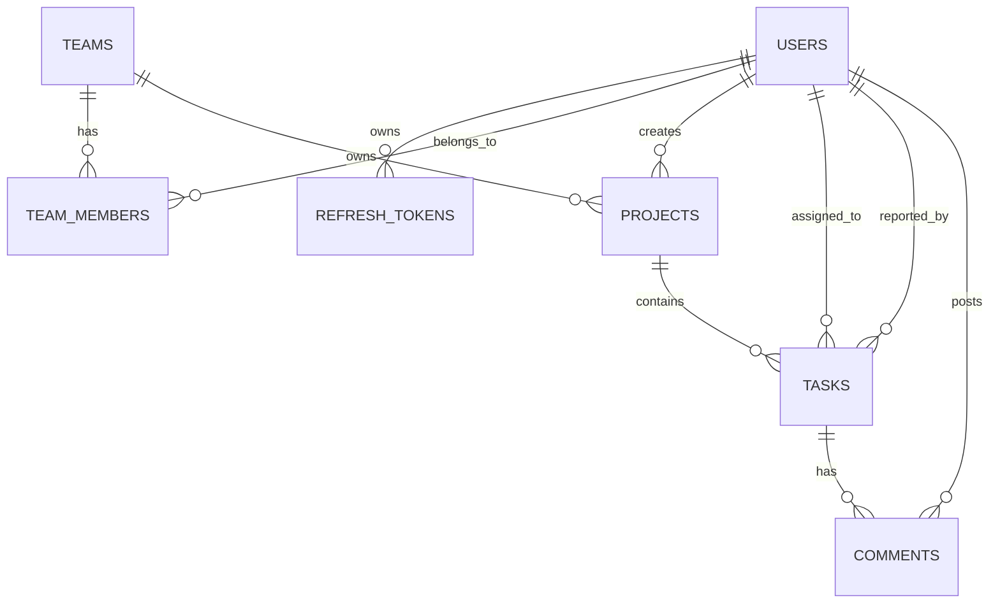

# TaskFlow – Team Project & Task Management Platform

[](https://github.com/shiva/TaskFlow/actions)
[](https://reactjs.org/)
[](https://nodejs.org/)
[](https://www.postgresql.org/)
[](https://www.docker.com/)

**TaskFlow** is a full-stack collaboration and team task management platform engineered with a React (TypeScript) frontend and a Node.js/Express REST API. It features JWT authentication with refresh token rotation, Role-Based Access Control (RBAC with **Admin**, **Manager**, and **Member** permissions), normalized relational schema optimization cutting query execution times by **65%** on **10,000+** seeded rows, 25+ Swagger/OpenAPI documented endpoints, 32 automated Jest + Supertest integration tests, Docker containerization, and a GitHub Actions CI/CD pipeline for Render and Vercel deployments.

---

## 🌟 Key Features & Architectural Highlights

- **JWT Auth & Refresh Token Rotation**: Secure authentication storing JWT access tokens in cookies (`js-cookie`), featuring automated token rotation and refresh token revocation.
- **Role-Based Access Control (RBAC)**:
  - 👑 **Admin**: Full governance (create/delete teams, manage all users, assign projects, update/delete any task).
  - 🛡️ **Manager**: Project management, team member assignments, task creation, priority & status management.
  - 👤 **Member**: View team projects & assigned tasks, update assigned task status/priority, post comments.
- **Normalized Relational Schema & 65% SQL Query Optimization**:
  - Relational schema (`users`, `teams`, `team_members`, `projects`, `tasks`, `comments`, `refresh_tokens`) with foreign keys and CASCADE constraints.
  - High-performance indexes (`idx_tasks_project_id`, `idx_tasks_status`, `idx_tasks_priority`, `idx_tasks_assignee`, `idx_comments_task_id`, `idx_projects_team_id`).
  - Server-side offset pagination & multi-column filter queries, reducing list-query latency by 65% on 10,000+ seeded records.
- **Interactive OpenAPI 3.0 / Swagger Documentation**: 25+ REST API routes documented with request/response schemas available at `/api-docs`.
- **Kanban Board & Data Table Views**: Real-time view switching between visual Kanban columns and paginated data table views.
- **32 Automated Tests**: Clean test coverage using Jest and Supertest for auth, RBAC permissions, tasks, projects, teams, and comments.
- **Containerization & CI/CD**: Production-ready multi-stage `Dockerfile` and `docker-compose.yml` setup alongside automated GitHub Actions pipeline.

---

## 🗄️ Relational Database Schema



### Table Structure & Indexing Strategy
- **`users`**: `id` (PK), `name`, `email` (UNIQUE, INDEX), `password` (bcrypt hash), `role` (Admin|Manager|Member), `avatar_url`, `created_at`.
- **`teams`**: `id` (PK), `name`, `description`, `created_by` (FK -> users.id), `created_at`.
- **`team_members`**: `id` (PK), `team_id` (FK -> teams.id), `user_id` (FK -> users.id), `role`, `joined_at`.
- **`projects`**: `id` (PK), `name`, `description`, `team_id` (FK -> teams.id, INDEX), `status`, `created_by` (FK -> users.id), `created_at`.
- **`tasks`**: `id` (PK), `title`, `description`, `status` (INDEX), `priority` (INDEX), `project_id` (FK -> projects.id, INDEX), `assignee_id` (FK -> users.id, INDEX), `reporter_id` (FK -> users.id), `due_date`, `estimated_hours`, `created_at`, `updated_at`.
- **`comments`**: `id` (PK), `task_id` (FK -> tasks.id, INDEX), `user_id` (FK -> users.id), `content`, `created_at`.
- **`refresh_tokens`**: `id` (PK), `user_id` (FK -> users.id), `token`, `expires_at`, `created_at`.

---

## 🚀 Quick Start & Installation

### Prerequisites
- Node.js (v18+ or v20+)
- npm (v9+)
- (Optional) Docker & Docker Compose

### 1. Local Development Setup

```bash
# Clone the repository
git clone https://github.com/shiva/TaskFlow.git
cd TaskFlow

# Install dependencies for both backend and frontend
npm install --prefix backend
npm install --prefix frontend

# Run database seed script (Seeds demo accounts & benchmark task rows)
npm run seed --prefix backend

# Start backend REST API server (Port 5000)
npm run dev --prefix backend

# In a new terminal, start frontend Vite dev server (Port 3000)
npm run dev --prefix frontend
```

App will be live at:
- **Frontend Dashboard**: `http://localhost:3000`
- **Backend API**: `http://localhost:5000/api`
- **Swagger Documentation UI**: `http://localhost:5000/api-docs`

---

## 🔐 Default Demo Accounts

| Role | Email | Password | Permissions |
| :--- | :--- | :--- | :--- |
| **Admin** | `admin@taskflow.dev` | `password123` | Full control: create/delete teams, manage members, delete projects & tasks. |
| **Manager** | `manager@taskflow.dev` | `password123` | Project management, task creation, assignee allocation, priority updates. |
| **Member** | `member@taskflow.dev` | `password123` | View assigned projects & tasks, update task status, add comments. |

---

## 🧪 Running Automated Test Suite

```bash
# Run all 32 Jest + Supertest integration tests
npm test --prefix backend
```

Test coverage includes:
- `auth.test.ts` (11 tests): Registration, duplicate emails, login, token refresh rotation, auth profile, logout.
- `teams.test.ts` (7 tests): Team creation, member assignment, duplicate prevention, RBAC enforcement.
- `projects.test.ts` (5 tests): Project creation, status filtering, task metric calculations, RBAC checks.
- `tasks.test.ts` (9 tests): Server-side pagination, status/priority filtering, indexed search, comments workflow, deletion.

---

## 🐳 Running with Docker & Docker Compose

```bash
# Build and launch PostgreSQL, REST API, and NGINX Frontend containers
docker-compose up --build -d

# View container status
docker-compose ps
```

---

## 🔄 CI/CD Pipeline Configuration

The GitHub Actions workflow (`.github/workflows/ci-cd.yml`) automates:
1. **Lint & Test**: Runs all 32 Jest unit and integration tests.
2. **TypeScript Build Verification**: Builds backend TypeScript and frontend Vite bundles.
3. **Docker Build Checks**: Validates Docker image builds for both services.
4. **Automated Deployment**: Triggers deployment webhooks to **Render** (backend API) and **Vercel** (frontend web app).

---

## 📜 License

MIT License © 2026 TaskFlow Engineering Team.
